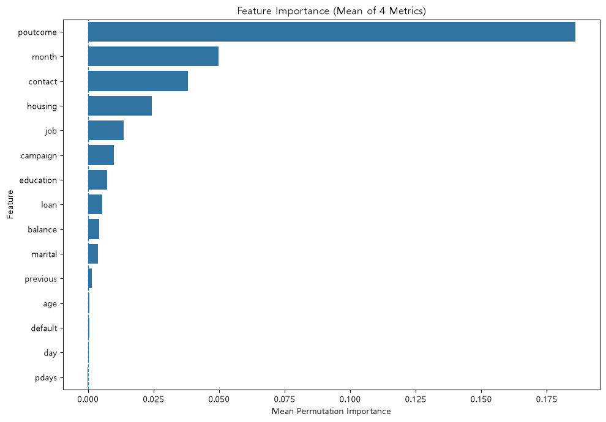
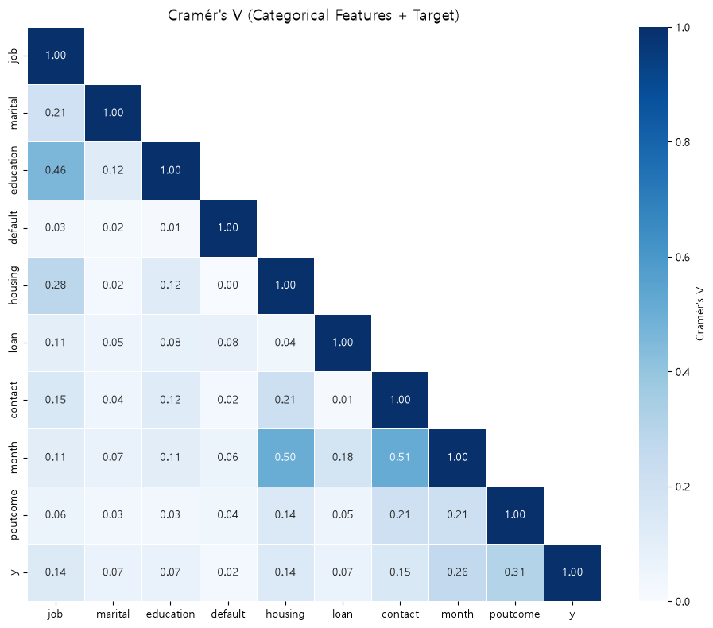

# 🏦 정기예금 가입 고객 예측 모델링 프로젝트

> **은행 마케팅 데이터 기반 정기예금 가입 예측** | 예금술사(team) · 2조
>
> 고객 특성과 과거 마케팅 이력을 활용해 **정기예금에 가입할 고객을 전화하기 전에 식별**하고, 전화 마케팅 대상 선정의 정확도와 마케팅 비용 효율을 높이는 이진 분류 프로젝트입니다.

| 항목 | 내용 |
|---|---|
| 데이터 | UCI Bank Marketing `bank-full.csv` (45,211행 × 17열, 2008.05 ~ 2010.11, 날짜순 정렬) |
| 문제 유형 | 이진 분류 (Binary Classification) |
| Target | `y` : 정기예금 가입 여부 (yes = 1, Positive / no = 0, Negative) |
| 최종 모델 | **XGBoost + Random Under Sampling(1:3) + 재튜닝 + 임계값 0.466** |
| 최종 Test 성능 | Recall **0.561** · Precision **0.501** · F1 **0.530** · PR-AUC **0.486** |
| 기대 효과 | 전체 고객의 **13.1%에게만 전화**해 가입 고객의 **56.1%**를 찾음, 전화당 가입률 **50.1%** (무작위 11.7% 대비 **약 4.3배**) |

---

## 📑 목차
1. [프로젝트 소개 및 문제 정의](#1-프로젝트-소개-및-문제-정의)
2. [데이터 분석 및 모델링 과정](#2-데이터-분석-및-모델링-과정)
3. [모델 성능 비교 및 최종 결과](#3-모델-성능-비교-및-최종-결과)
4. [회고 및 개선 방향](#4-회고-및-개선-방향)

---

## 1. 프로젝트 소개 및 문제 정의

### 1-1. 데이터와 도메인

**도메인: 은행의 아웃바운드 전화 마케팅(텔레마케팅)**

포르투갈 은행이 정기예금 상품을 판매하기 위해 진행한 전화 마케팅 캠페인 기록입니다(UCI Machine Learning Repository, CC BY 4.0).

| 정보 유형 | 변수 |
|---|---|
| 고객 기본 정보 | `age`, `job`, `marital`, `education` |
| 금융 정보 | `default`(신용 불이행), `balance`(연평균 잔액), `housing`(주택 대출), `loan`(개인 대출) |
| 이번 캠페인 접촉 정보 | `contact`(연락 방식), `day`, `month`, `campaign`(연락 횟수), ~~`duration`~~(통화 시간, 누수로 제외) |
| 과거 캠페인 이력 | `pdays`(이전 연락 후 경과일), `previous`(이전 연락 횟수), `poutcome`(이전 결과) |

**추진 배경과 기존 방식의 한계**

- 가입 고객은 전체의 **11.7%(5,289명)**뿐이어서 **통화 10건 중 약 9건이 미가입**으로 끝납니다.
- 기존 방식은 고객별 가입 가능성을 고려하지 않고 **모든 고객에게 상담 인력과 시간을 똑같이 배분**합니다.
- 그 결과 가입 1건당 마케팅 비용이 높아지고, 가입 의사가 없는 고객에게 반복 연락해 **고객 피로도**도 높아집니다.

**문제 정의**

> 고객의 가입 가능성을 구분하지 않는 일괄 전화 마케팅으로 가입률이 11.7%에 머물러, 가입 1건당 비용이 높고 상담 자원이 비효율적으로 쓰이는 문제
>
> → 고객 정보와 과거 마케팅 이력으로 **연락 전에** 가입 가능성이 높은 고객을 예측해 우선 연락 대상을 선정한다.

### 1-2. Target과 Class의 의미

| Class | 의미 | 건수 | 비율 |
|---|---|---|---|
| `1` (yes, Positive) | 상담 후 정기예금에 **가입한** 고객 → 우선 연락해야 할 대상 | 5,289 | 11.7% |
| `0` (no, Negative) | 가입하지 **않은** 고객 → 연락 우선순위를 낮출 대상 | 39,922 | 88.3% |

**분석 단위:** 캠페인별 마지막 연락 기록 1건 = 1행 (고객 식별자 없음)

### 1-3. 클래스 불균형 정도

- **미가입 : 가입 ≈ 7.5 : 1** (Train 기준 no 23,944 / yes 3,173)
- **모든 고객을 "미가입"으로 예측해도 Accuracy가 88.3%** → Accuracy만으로는 모델을 평가할 수 없음

### 1-4. 중요하게 고려한 오분류

| 오분류 | 현장에서 일어나는 일 | 비용 |
|---|---|---|
| **FN** (가입할 고객 → 미가입 예측) | 가입할 고객에게 **연락조차 하지 않음** | **매출 기회 손실** → 가장 중요하게 고려 |
| **FP** (미가입 고객 → 가입 예측) | 가입하지 않을 고객에게 전화 | 상담 비용·시간 낭비, **고객 피로도 증가** |

이 프로젝트의 출발점은 "가입할 고객을 놓치지 말자(FN 감소)"였습니다. 하지만 EDA에서 **연락 횟수가 늘수록 가입률이 오히려 떨어진다**(4회 이상 7.4%, 평균의 0.63배)는 것을 확인했기 때문에, FP를 무한정 늘리는 전략도 바람직하지 않다고 판단했습니다.

> **성공 기준:** 불균형 처리를 하지 않은 Baseline 대비 **Recall을 개선하면서 Precision이 급락하지 않는 모델**을 찾고, Validation과 Test에서 성능이 유지되는지 확인한다.

### 1-5. 핵심 평가 지표와 선정 이유

| 지표 | 역할 | 사용 단계 | 이유 |
|---|---|---|---|
| **PR-AUC** | **핵심** | 하이퍼파라미터 튜닝, 최종 모델 선택 | 임계값과 무관하게 **가입 고객을 예측 순위 상위에 올리는 능력**을 평가. 불균형 데이터에서 소수 클래스 성능에 민감 (무작위 기준선 = 0.117) |
| **Accuracy·Precision·Recall·F1 평균 순위** | **핵심** | 불균형 처리 조합 비교 | 처리 방법에 따라 지표들이 **서로 반대로 움직여** 지표별 1등이 모두 달랐음 → 네 지표를 고르게 잘하는 조합을 고르기 위해 평균 순위 사용 |
| **F1** | 보조 | 최종 임계값 결정 | Recall(FN)과 Precision(FP)의 균형점 |
| Recall / Precision | 보조 | 결과 해석 | 놓친 가입자(FN) / 헛걸음 연락(FP)을 직접 반영 |
| Accuracy | 참고 | – | 불균형 때문에 항상 높게 나옴 |

---

## 2. 데이터 분석 및 모델링 과정

### 2-1. EDA로 확인한 주요 데이터 특성과 문제점

**① `duration`(통화 시간)은 데이터 누수 → 제외**
통화가 끝나야 확정되는 값이라 "전화하기 전 예측"이라는 목적과 맞지 않습니다.

**② 가장 강한 신호: 이전 캠페인 결과(`poutcome`)와 연락 시기(`month`)**



| 가설 | 결론 | 핵심 근거 | IV |
|---|---|---|---|
| 특정 연령대의 가입률이 다를까? | 채택 | **U자형**: 20대 이하 17.6%, 60대 이상 33.6% vs 30~50대 9~11% | 0.178 (중간) |
| 잔고에 따라 가입률이 다를까? | 채택 | 잔고 0 이하 6.9% → 상위 구간 15.7% (단조 증가) | 0.102 (중간) |
| 특정 월에 가입률이 높을까? | 채택 | 3·9·10·12월 46.8% vs 5월 6.7% | 0.436 (강함) |
| 이전 캠페인 성공 고객은 가입률이 높을까? | 채택 | success 고객 64.7%, 평균의 **5.5배** | 0.515 (강함) |
| 많이 연락할수록 가입률이 높을까? | **기각** | 1회 14.6% → 11회 이상 3.9%로 **감소** | – |

**③ 변수 간 연관성** — `month`↔`contact`(0.51), `month`↔`housing`(0.50), `job`↔`education`(0.46). 캠페인이 특정 달에 특정 연락 방식·고객층으로 집중되었음을 보여줍니다. 수치형 변수끼리의 상관은 매우 약했습니다.



**④ 캠페인 규모와 가입률의 관계**
데이터가 날짜순으로 정렬되어 있다는 점을 이용해 연도를 복원하고 월별 상담 건수와 가입률을 함께 보았습니다.


**상담 건수가 많은 달은 가입률이 낮고, 적은 달은 높았습니다.** "몇 월이냐"보다 **"그 시기에 얼마나 대량으로 연락했느냐"**가 가입률과 강하게 연결되어 있다는 뜻이고, 이후 피처 설계(`month_contacts`)의 근거가 됩니다.

### 2-2. 데이터 품질 확인과 처리

원칙: **"감으로 정하지 않고, Baseline(Logistic Regression) 성능 비교 실험으로 결정한다."**

| 점검 항목 | 확인 결과 | 처리 | 근거 |
|---|---|---|---|
| 결측치 (NaN) | 0건 | – | – |
| `unknown` 값 | job 0.6%, education 4.1%, contact 28.8%, poutcome 81.8% | **범주로 그대로 유지** | job↔education 연관성(카이제곱 p<0.001)을 근거로 분류모델 대체·조건부 최빈값 대체 등 **8가지 실험** → PR-AUC 차이 0.0004 이내로 대체 효과 없음 |
| `poutcome=unknown`, `pdays=-1` | `previous=0`이면 항상 unknown / -1 | 의미 있는 값으로 유지 | "이전 연락 없음"이라는 정보 자체 |
| 완전 중복 | 0건 | – | – |
| 고객 정보 기준 중복 의심 | 3,141건 (2,404그룹) | **유지** | 행 간 날짜 차이와 `pdays`가 **90.6% 일치** → 같은 고객의 **다른 시점 연락 기록**으로 판단 |
| `duration` 제외 후 중복 | 16건 (모두 y=0) | **분할 전에 삭제** | 같은 행이 Train/Test에 동시에 들어가는 누수 방지 |
| `balance` 이상치 | IQR 기준 10.5%, 음수 8.3% | **유지** | 마이너스 통장·고액 예금은 실제로 가능한 값 |
| `previous` 이상치 | 최댓값 275 (99% 분위 17) | **유지** | P99 클리핑 / IQR 삭제 / 최댓값 삭제 실험 → PR-AUC 차이 ≤ 0.0013 |
| 날짜 유효성 | 월별 최대 일수 초과 0건 | – | – |

**파생 변수**

| 변수 | 정의 | 근거 |
|---|---|---|
| `age_group` | 연령대 (10세 단위) | 연령대별 U자형 가입률 |
| `balance_group` | 0 이하 / 하위(~338) / 중위(~1,243) / 상위 | 부트스트랩 결정트리에서 **0 근처 경계만 매번 안정적**으로 등장 → 0은 고정, 나머지는 Train 분위수로 3등분 |
| `month_contacts` | 같은 연도-월의 상담 건수 | 대량 연락 시기일수록 가입률이 낮은 패턴 (타깃 `y` 미사용) |

### 2-3. Baseline 모델과 초기 성능

**① 전처리 실험용 Baseline** — Logistic Regression, 최소 전처리, Validation

| Accuracy | Precision | Recall | F1 | ROC-AUC | PR-AUC |
|---|---|---|---|---|---|
| 0.894 | 0.683 | **0.175** | 0.278 | 0.764 | 0.406 |

Accuracy는 89%지만 **실제 가입자의 17.5%만 찾아냅니다.** 불균형 데이터의 전형적인 증상입니다.

**② 모델 비교 Baseline** — 5개 모델을 GridSearchCV(5-fold, PR-AUC)로 **가볍게** 튜닝 후 Validation 평가 (불균형 처리 없음)

| 모델 | CV PR-AUC | Val PR-AUC | Recall | Precision | F1 |
|---|---|---|---|---|---|
| **LightGBM** | 0.479 | **0.477** | 0.267 | 0.623 | 0.373 |
| XGBoost | 0.477 | 0.475 | 0.273 | 0.615 | 0.378 |
| RandomForest | 0.469 | 0.461 | 0.178 | 0.707 | 0.284 |
| LogisticRegression | 0.449 | 0.437 | 0.217 | 0.634 | 0.324 |
| DecisionTree | 0.444 | 0.426 | 0.301 | 0.561 | 0.391 |

부스팅 계열이 PR-AUC에서 앞섰지만, **모든 모델의 Recall이 0.18~0.30**에 머물렀습니다.

### 2-4. 클래스 불균형 처리

5개 모델 × 7개 방법 = **35개 조합**을 같은 조건(튜닝된 하이퍼파라미터 고정, Validation)에서 비교했습니다.

| 방법 | 원리 | 선택 이유 |
|---|---|---|
| `class_weight='balanced'` | 데이터는 그대로, yes 오분류에 약 7.5배 손실 (XGBoost는 `scale_pos_weight`) | 데이터 손실·왜곡 없음 |
| **RUS** 1:1 / 1:2 / 1:3 | 미가입(no)을 무작위로 줄임 | 빠르고 단순, 비율로 정보 손실 정도 조절 |
| **SMOTE-NC** 1:1 / 1:2 / 1:3 | 가입(yes) 이웃 사이를 보간해 새 샘플 생성 | 수치형+범주형 혼합 데이터 → 범주형은 보간하지 않는 SMOTE-NC 사용 (존재할 수 없는 범주값 방지) |

> **누수 방지 설계:** 샘플링은 `imblearn.Pipeline`의 첫 단계로 넣어 **학습 fold에만 적용**되고, 검증 fold·Validation·Test는 실제 분포를 유지합니다.

**PR-AUC (Validation)**

| 모델 | 처리 전 | class_weight | RUS 1:1 | RUS 1:2 | RUS 1:3 | SMOTE 1:1 | SMOTE 1:2 | SMOTE 1:3 |
|---|---|---|---|---|---|---|---|---|
| LightGBM | **0.477** | 0.470 | 0.427 | 0.455 | 0.461 | 0.443 | 0.461 | 0.470 |
| XGBoost | 0.475 | 0.471 | 0.433 | 0.459 | 0.464 | 0.433 | 0.454 | 0.461 |
| RandomForest | 0.461 | 0.457 | 0.438 | 0.450 | 0.452 | 0.425 | 0.446 | 0.453 |

**Recall / Precision (Validation, 임계값 0.5)**

| 모델 | 처리 전 | class_weight | RUS 1:1 | RUS 1:2 | **RUS 1:3** | SMOTE 1:2 |
|---|---|---|---|---|---|---|
| LightGBM | 0.267 / 0.623 | 0.615 / 0.406 | 0.639 / 0.357 | 0.567 / 0.456 | **0.522 / 0.488** | 0.458 / 0.532 |
| XGBoost | 0.273 / 0.615 | 0.614 / 0.385 | 0.634 / 0.353 | 0.556 / 0.459 | **0.508 / 0.487** | 0.428 / 0.533 |

**관찰:**
- 불균형 처리로 **Recall이 약 2배** 올랐지만 PR-AUC는 오히려 소폭 하락했습니다.
- 1:1처럼 강하게 맞출수록 Precision이 0.35 근처까지 떨어져 **헛걸음(FP)이 폭증**했습니다.
- **1:3 정도의 중간 강도**가 Precision을 덜 희생하면서 Recall을 올리는 지점이었습니다.

**재튜닝 후보 선정:** 네 지표(Accuracy·Precision·Recall·F1)의 **평균 순위**로 정렬해 모델별 최고 조합 3개를 선택했습니다.

| 순위 | 조합 | Precision | Recall | F1 | 평균 순위 |
|---|---|---|---|---|---|
| 1 | LightGBM \| RUS 1:3 | 0.488 | 0.522 | 0.504 | 12.25 |
| 4 | XGBoost \| RUS 1:3 | 0.487 | 0.508 | 0.497 | 13.50 |
| 7 | RandomForest \| SMOTE-NC 1:2 | 0.501 | 0.471 | 0.485 | 15.00 |

### 2-5. Cross Validation과 Hyperparameter Tuning

**2단계 튜닝 전략: 가볍게 튜닝 → 불균형 처리 비교 → 선택된 조합으로 다시 튜닝**

처음부터 모든 조합을 크게 튜닝하면 시간이 너무 오래 걸리기 때문에, 먼저 "망가지지 않은 공정한 Baseline"만 만든 뒤 유망한 조합에 탐색 자원을 집중했습니다.

- **CV:** `StratifiedKFold(n_splits=5, shuffle=True)` — 모든 fold에서 가입 비율 11.7% 유지, 날짜순 정렬 데이터라 셔플
- **튜닝 기준:** `GridSearchCV(scoring=PR-AUC)`, F1·Recall은 함께 기록
- **탐색 범위 확장:** 1차 튜닝에서 최적값이 **탐색 범위의 끝**(XGBoost depth=3, LightGBM lr=0.05 등)에 걸려 → 더 작은 값과 `subsample`, `min_child_samples`, `max_features` 추가

| 조합 | 선택된 주요 파라미터 | CV PR-AUC | Val PR-AUC (튜닝 전 → 후) | 탐색 시간 |
|---|---|---|---|---|
| **XGBoost \| RUS 1:3** | depth=5, lr=0.03, n=300, subsample=0.8 | 0.478 | 0.464 → **0.467** | 79초 |
| LightGBM \| RUS 1:3 | leaves=15, lr=0.03, n=300, min_child=50 | 0.479 | 0.461 → 0.463 | 68초 |
| RandomForest \| SMOTE-NC 1:2 | depth=10, leaf=20, max_features=0.3, n=500 | 0.456 | 0.446 → 0.449 | **1,104초** |


세 조합 모두 재튜닝 후 성능이 올랐지만 개선 폭은 PR-AUC +0.002~0.004로 작았습니다.

**임계값 조정:** 기본값 0.5 대신 Validation에서 **F1이 최대가 되는 0.466**을 선택했습니다 (Recall 0.521 → 0.540, F1 0.503 → 0.510).


### 2-6. 어려웠던 부분과 해결 방법

**① `year` 변수의 딜레마**
복원한 연도별 가입률이 2008년 5.1% → 2010년 51.6%로 크게 달라, `year`를 넣으면 성능이 오릅니다. 하지만 모델이 "몇 년도면 가입 확률이 높다"를 외우게 되고, **앞으로 쓸 미래 연도는 학습 때 본 적이 없는 값**이라 실제로 활용할 수 없습니다.

→ **해결:** EDA에서 확인한 "대량 연락 시기일수록 가입률이 낮다"는 패턴을 근거로, `year` 대신 **`month_contacts`(해당 월 상담 건수)**를 만들었습니다.

| PR-AUC (Validation) | year 포함 | year 제외 | **month_contacts로 대체** |
|---|---|---|---|
| LightGBM | 0.474 | 0.442 | **0.477** |
| XGBoost | 0.469 | 0.438 | **0.475** |
| RandomForest | 0.459 | 0.422 | **0.461** |
| LogisticRegression | 0.433 | 0.406 | **0.437** |

`year`를 빼면 성능이 0.03 이상 떨어지지만, `month_contacts`가 그 역할을 충분히 대체하면서 모든 모델에서 오히려 조금 더 높았습니다.

**② `unknown`·이상치 처리 방식 결정**
통계 검정까지 거쳐 정교한 대체 규칙을 만들었지만 효과가 없었습니다. → "성능 차이가 없다면 원본을 유지하는 것이 가장 단순하고 해석하기 쉽다"는 기준으로 결정했습니다.

**③ 깊이 제한 없는 Decision Tree의 과적합**
`max_depth=None, min_samples_leaf=1`에서 예측 확률이 0/1로만 나와 PR-AUC 비교가 무의미해졌습니다. → `min_samples_leaf`를 20~300까지 넓게 탐색해 해결했습니다 (최종 depth=10, leaf=50).

**④ 계산 비용이 큰 SMOTE-NC**
RandomForest + SMOTE-NC 재튜닝은 48개 조합에 약 18분이 걸렸습니다 (RUS 조합의 약 14배). `k_neighbors` 튜닝은 시간이 3배 늘어나 옵션(`TUNE_K_NEIGHBORS=False`)으로 분리했습니다.

---

## 3. 모델 성능 비교 및 최종 결과

### 3-1. 불균형 처리 전후 성능 변화 (XGBoost 기준)


| 지표 | 처리 전 (Val, 임계값 0.5) | RUS 1:3 + 재튜닝 (Val, 임계값 0.466) | **최종 Test (임계값 0.466)** | 변화 |
|---|---|---|---|---|
| Accuracy | 0.895 | 0.879 | 0.883 | ▼ 소폭 감소 |
| Precision | 0.615 | 0.484 | 0.501 | ▼ 감소 |
| **Recall** | 0.273 | 0.540 | **0.561** | ▲ **약 2배** |
| **F1** | 0.378 | 0.510 | **0.530** | ▲ **+0.15** |
| PR-AUC | 0.475 | 0.467 | 0.486 | ≈ 유지 |
| ROC-AUC | 0.805 | 0.808 | 0.818 | ≈ 유지 |

### 3-2. Confusion Matrix 변화

| | 처리 전 XGBoost (Validation) | | **최종 모델 (Test)** | |
|---|---|---|---|---|
| | 예측 미가입 | 예측 가입 | 예측 미가입 | 예측 가입 |
| **실제 미가입** | 7,800 (TN) | 181 (FP) | 7,390 (TN) | 591 (FP) |
| **실제 가입** | **769 (FN)** | 289 (TP) | **464 (FN)** | **594 (TP)** |

- **찾아낸 가입 고객(TP): 289명 → 594명** (약 2배)
- **놓친 가입 고객(FN): 769명 → 464명** (약 40% 감소)
- 대가: **헛걸음 연락(FP): 181건 → 591건**

### 3-3. 개선된 점과 Trade-off

| 구분 | 내용 |
|---|---|
| **개선** | Recall·F1이 크게 상승 → "가입자를 4명 중 1명만 찾는 모델"에서 **"절반 이상 찾는 모델"**로 변화 |
| **감소** | Precision 0.615 → 0.501, Accuracy 0.895 → 0.883, FP 약 3배 증가 |
| **Trade-off 해석** | Precision 0.50은 **전화 2건 중 1건이 가입**한다는 의미로, 무작위 연락(11.7%) 대비 **약 4.3배** 효율. 1:1 처리(Precision 0.35)처럼 FP가 폭증하는 지점은 피함 |
| **핵심 통찰** | PR-AUC는 거의 그대로 → 불균형 처리는 **고객을 줄 세우는 능력**보다 **"가입"으로 판단하는 기준을 낮추는 효과**가 컸음 |

**비즈니스 관점 (Test 9,039명 기준)**
모델이 "가입"으로 분류한 **1,185명(13.1%)에게만 전화하면 594명이 가입**합니다. 같은 인원에게 무작위로 전화했다면 약 139명이 가입했을 것으로 예상되므로 약 4.3배의 효율입니다.

### 3-4. 최종 선택

> ### XGBoost + RUS 1:3 + 재튜닝 + 임계값 0.466
> `max_depth=5`, `learning_rate=0.03`, `n_estimators=300`, `subsample=0.8`

Validation(F1 0.510)과 Test(F1 0.530) 성능이 비슷하게 유지되어, 여러 실험을 거치며 Validation에 과적합되지 않았음을 확인했습니다. Test는 모든 결정이 끝난 뒤 **한 번만** 평가했습니다.

### 3-5. 선택 근거와 다른 모델 대비 장단점

| 후보 | 장점 | 단점 | 판단 |
|---|---|---|---|
| **XGBoost \| RUS 1:3** ✅ | 재튜닝 후 **Val PR-AUC 최고(0.467)**, Recall·Precision 균형, 학습 0.18초 | 언더샘플링으로 미가입 데이터 일부를 버림 | **최종 선택** |
| LightGBM \| RUS 1:3 | 평균 순위 1위, 성능 거의 동일(0.463), 빠름 | PR-AUC 근소하게 낮음 | 사실상 대체 가능한 차선책 |
| RandomForest \| SMOTE-NC 1:2 | Precision 0.504로 가장 높음 | PR-AUC 0.449로 가장 낮음, 학습 4초·튜닝 18분 | 비용 대비 이점 부족 |
| 처리 전 LightGBM | PR-AUC 최고(0.477), Precision 높음 | Recall 0.27 → 가입 고객 대부분을 놓침 | 목적(FN 감소)과 불일치 |
| class_weight 계열 | 데이터 손실 없음 | Recall 0.61에 Precision 0.38~0.41 → FP 과다 | 연락 비용·피로도 측면에서 과함 |

**최종 모델의 Permutation Importance (PR-AUC 감소량, Validation)**

| 순위 | 변수 | 중요도 | 해석 |
|---|---|---|---|
| 1 | `month_contacts` | **0.206** | 대량 연락 시기 여부가 가장 강한 신호 |
| 2 | `poutcome` | 0.063 | 이전 캠페인 성공 고객이 핵심 |
| 3 | `month` | 0.030 | |
| 4 | `day` | 0.029 | |
| 5 | `contact` | 0.021 | |

`age_group`, `balance_group`의 중요도는 0 이하로, 트리 모델은 원본 `age`, `balance`에서 이미 같은 정보를 학습하고 있었습니다.

---

## 4. 회고 및 개선 방향

### 4-1. 새롭게 알게 된 점
- **Accuracy의 함정:** 정확도 89%짜리 모델이 가입자의 17%밖에 찾지 못할 수 있었습니다. 불균형 문제에서는 **어떤 지표를 보느냐가 곧 문제 정의**였습니다.
- **불균형 처리 ≠ 모델 실력 향상:** 샘플링은 Recall과 Precision의 **교환 비율**을 바꾸는 도구였고, 순위를 매기는 능력(PR-AUC)을 키워주지는 않았습니다.
- **"무엇을 넣을지"보다 "무엇을 넣으면 안 되는지":** `duration`(통화 후 정보), 분할 전 중복 행, 전체 데이터로 계산한 분위수, `year`(미래에 쓸 수 없는 값)처럼 누수는 다양한 형태로 숨어 있었습니다.
- **데이터 설명 한 줄의 가치:** "날짜순 정렬"이라는 설명에서 연도를 복원했고, 그것이 가장 중요한 피처(`month_contacts`)로 이어졌습니다.

### 4-2. 예상과 달랐던 결과와 시행착오
- **`unknown` 대체와 이상치 처리는 효과가 없었다.** 카이제곱 검정(p<0.001), ANOVA(F=1504)까지 거쳐 대체 규칙을 만들었지만 8개 실험의 PR-AUC 차이가 0.0004 이내였습니다.
- **"많이 연락할수록 가입한다"는 가설은 정반대였다.** 4회 이상 연락 고객의 가입률은 평균의 0.63배였습니다.
- **재튜닝의 개선 폭이 작았다.** 탐색 범위를 넓혔지만 PR-AUC +0.002~0.004 수준이었습니다. 하이퍼파라미터보다 **데이터·피처가 성능의 병목**이라는 신호로 해석했습니다.
- **공들인 파생 변수의 기여가 거의 없었다.** IV로 근거를 갖춰 만든 `age_group`, `balance_group`이 최종 모델에서는 중요도 0이었습니다. 반면 단순한 `month_contacts`가 압도적인 1위였습니다.

### 4-3. 현재 모델과 분석 결과의 한계
1. **캠페인 운영 피처 의존:** 최종 모델이 `month_contacts`에 크게 의존합니다. 이 값은 "그 달 전체 상담 건수"라서 월초 예측 시점에는 확정되지 않으므로, 실제 운영에서는 **캠페인 계획상 연락 예정 건수**로 대체해야 합니다. 캠페인 규모나 운영 방식이 바뀌면 성능이 달라질 수 있습니다.
2. **반복 고객:** 고객 식별자가 없어, 같은 고객의 다른 시점 기록이 Train과 Test에 나뉘어 들어갔을 가능성을 배제하지 못했습니다.
3. **비용 정보 미반영:** 통화 1건의 비용과 가입 1건의 수익을 알 수 없어 임계값을 F1이라는 대리 기준으로 정했습니다.
4. **여전히 놓치는 가입 고객:** 실제 가입 고객의 약 44%(464명)는 미가입으로 분류됩니다. 따라서 예측 결과는 연락 **제외** 기준이 아니라 **우선순위 참고용**으로 활용해야 합니다.
5. **선택 기준이 단계별로 다름:** 후보 선정은 네 지표 평균 순위, 튜닝과 최종 선택은 PR-AUC, 임계값은 F1을 사용해 기준이 섞여 있습니다.

### 4-4. 시간이 더 주어진다면
- **비용 기반 임계값:** 상담 비용과 예금 기대 수익을 가정해 **기대 이익이 최대가 되는 임계값**을 찾고, **Recall@K / Precision@K**(상위 K명에게만 연락) 기준으로 평가
- **임계값만 조정한 모델과의 정면 비교:** PR-AUC가 가장 높았던 "처리 전 LightGBM"에 임계값만 낮췄을 때, 같은 Recall에서 Precision이 더 높은지 확인
- **모델 확장:** 코드에 준비해 두었지만 이번 비교에서 빠진 CatBoost(범주형 직접 처리), 서로 다른 계열 모델을 묶은 Stacking 실험
- **피처 보강:** `month_contacts`를 일·주 단위 연락 건수로 세분화, `bank-additional` 데이터의 금리·고용 지표 등 경제 지표 추가
- **해석 가능성:** SHAP으로 고객 단위 예측 근거를 제시해 상담원이 활용할 수 있는 형태로 가공
- **오분류 사례 분석:** FN·FP 고객 그룹의 특징을 분석해 모델이 놓치는 패턴과 데이터가 담지 못한 정보 구분

---

## 🛠 기술 스택
`Python` · `pandas` · `NumPy` · `scikit-learn` · `imbalanced-learn` · `XGBoost` · `LightGBM` · `SciPy` · `matplotlib` · `seaborn`

## 📁 프로젝트 구조
```
├── bank-full.csv                     # 원본 데이터 (세미콜론 구분)
├── 전처리.ipynb                      # EDA, 품질 점검, unknown/이상치 실험, 파생변수 → add_bank.csv
├── add_bank.csv                      # 전처리 결과 (age_group, year, balance_group 추가)
├── 모델_생성.ipynb                   # 모델 비교, 불균형 처리, 재튜닝, 임계값, 최종 평가
├── 전처리용_Baseline_모델_성능.pdf   # 전처리 실험 기록 및 의사결정 노트
├── kant_project1_DS_2팀.pdf          # 프로젝트 보고서
└── images/                           # README 시각화
```
